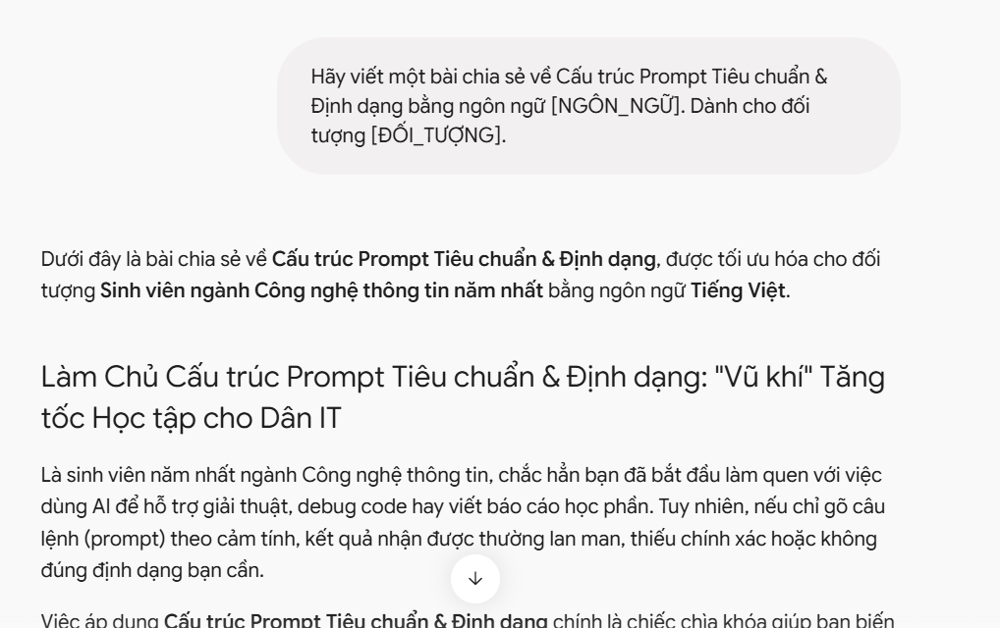
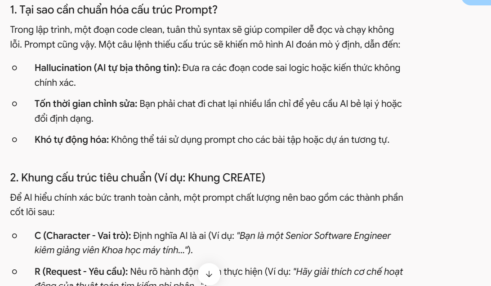
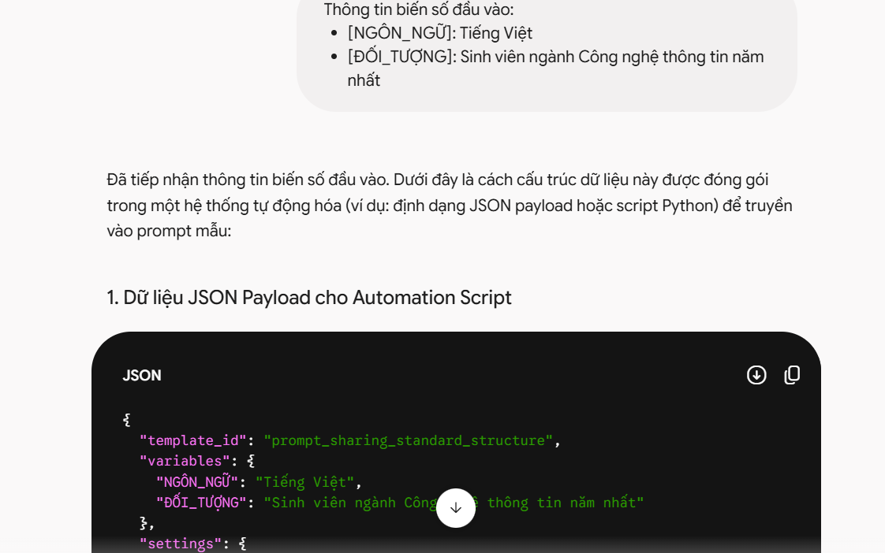
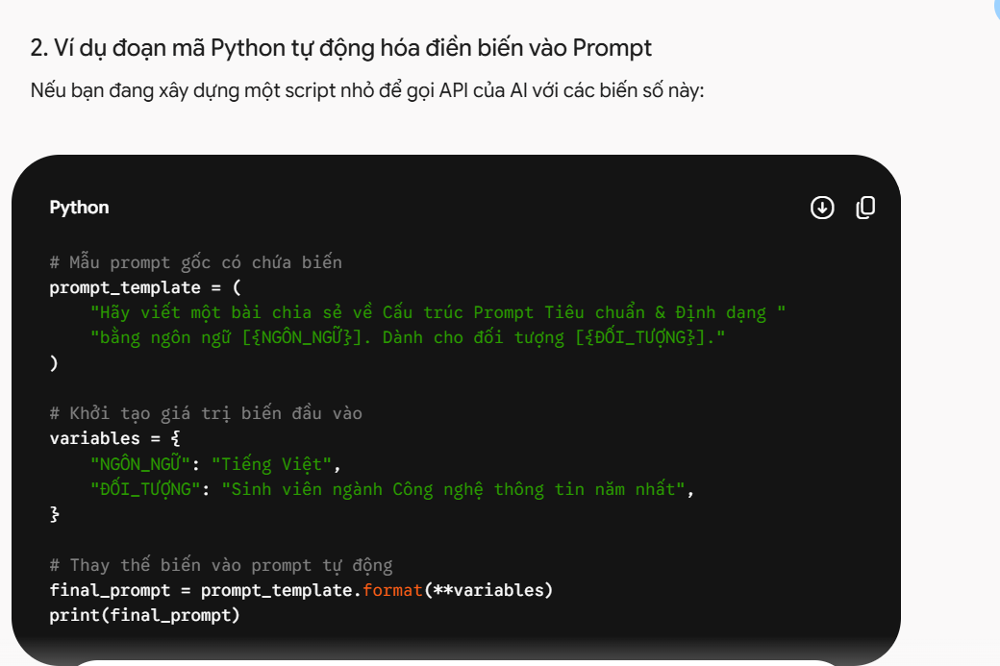

Đề bài / Yêu cầu
Khắc phục lỗi khai báo biến số trong prompt mẫu

Để tự động hóa viết email hoặc dịch thuật cho nhiều người, chúng ta thiết kế các prompt mẫu có chứa biến số để thay thế thông tin động vào.

2. Vấn đề hiện tại (Tại sao lại lỗi?)

Khai báo các biến số lộn xộn (lúc dùng ngoặc nhọn, lúc dùng ngoặc vuông) làm AI bị nhầm lẫn và không nhận diện được biến để thay thế.

3. Hiện trường giả (Prompt lỗi)

Prompt: Hãy viết một bài chia sẻ về Cấu trúc Prompt Tiêu chuẩn & Định dạng bằng ngôn ngữ [language]. Dành cho đối tượng {audience}.

4. Yêu cầu đầu ra chi tiết

Bước 1: Phân tích lỗi:

Giải thích vì sao cách đặt biến lộn xộn [language] và {audience} gây khó khăn cho việc tự động hóa.

Bước 2: Đồng bộ biến số:

Đưa toàn bộ biến về dạng nhất quán [NGÔN_NGỮ], [ĐỐI_TƯỢNG] viết hoa rõ ràng.

