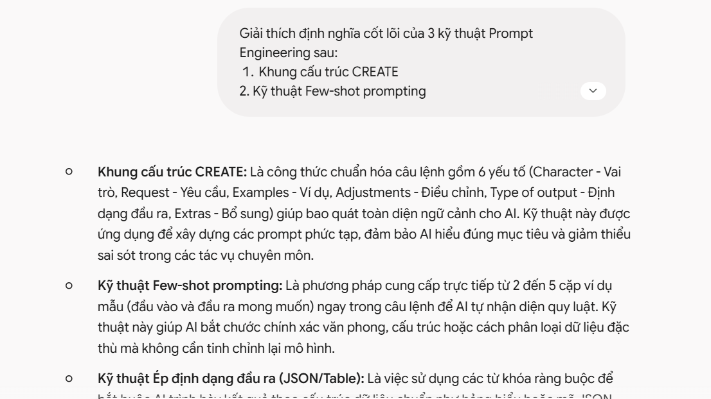
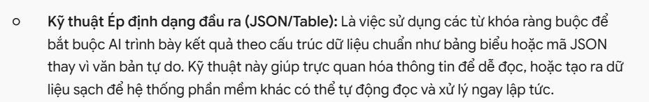

### Bước 1: Phân tích lỗi của Prompt cũ

Khi sử dụng prompt gốc (*"Hãy giải thích ngắn gọn các nội dung của CREATE, Few-shot, Ép định dạng JSON/Table"*), vì thiếu các **ràng buộc đầu ra (Output Constraints)** và **quy tắc phủ định (Negative Constraints)**, AI thường sinh ra 3 phần văn bản thừa thãi gây mất thời gian cắt gọt khi dán vào báo cáo:

1. **Lời chào và dẫn nhập xã giao (Introductory Fluff):** Các câu mở đầu vô nghĩa về mặt nội dung như *"Chào bạn! Dưới đây là giải thích ngắn gọn về các khái niệm bạn yêu cầu..."* hoặc *"Rất vui được hỗ trợ bạn tìm hiểu về kỹ thuật Prompt Engineering..."*.
2. **Câu chuyển ý và ví dụ minh họa lan man (Unrequested Elaboration):** AI tự ý thêm các đoạn ví dụ dài dòng hoặc các câu dẫn dắt rườm rà giữa các mục (ví dụ: *"Để hiểu rõ hơn về Few-shot, hãy cùng xem xét tình huống sau..."*) trong khi đề bài chỉ yêu cầu giải thích ngắn gọn khái niệm.
3. **Lời kết và gợi ý mở rộng (Closing Remarks / Call-to-Action):** Các câu chốt ở cuối như *"Hy vọng những thông tin trên hữu ích cho báo cáo của bạn. Nếu cần thêm ví dụ cụ thể, hãy cho tôi biết nhé!"*.

---

### Bước 2: Prompt tối ưu (Đã thêm cấu trúc & ràng buộc định dạng)

Bạn có thể sao chép trực tiếp mẫu prompt dưới đây để sử dụng:

```text
Giải thích định nghĩa cốt lõi của 3 kỹ thuật Prompt Engineering sau:
1. Khung cấu trúc CREATE
2. Kỹ thuật Few-shot prompting
3. Kỹ thuật Ép định dạng đầu ra (JSON/Table)

Yêu cầu ràng buộc định dạng bắt buộc:
- Chỉ trình bày bằng danh sách gạch đầu dòng (bullet points).
- Mỗi khái niệm giải thích tối đa 2 câu, đi thẳng vào bản chất và ứng dụng.
- KHÔNG viết lời chào mở đầu, không viết câu dẫn nhập.
- KHÔNG viết lời kết, không đưa ra ví dụ dài dòng hay câu hỏi gợi ý ở cuối.
- Trả về văn bản thuần túy để dán trực tiếp vào tài liệu.

```

**Điểm cải tiến chính trong Prompt mới:**

* **Định lượng độ dài:** Giới hạn *"tối đa 2 câu"* thay vì dùng từ *"ngắn gọn"* (vốn mang tính chủ quan đối với AI).
* **Ép cấu trúc hiển thị:** Chỉ định rõ *"danh sách gạch đầu dòng"* để dễ sao chép vào tài liệu học tập.
* **Chặn đứng văn bản thừa:** Dùng từ khóa viết hoa nhấn mạnh (`KHÔNG`) nhắm trực tiếp vào phần mở đầu và phần kết thúc.



